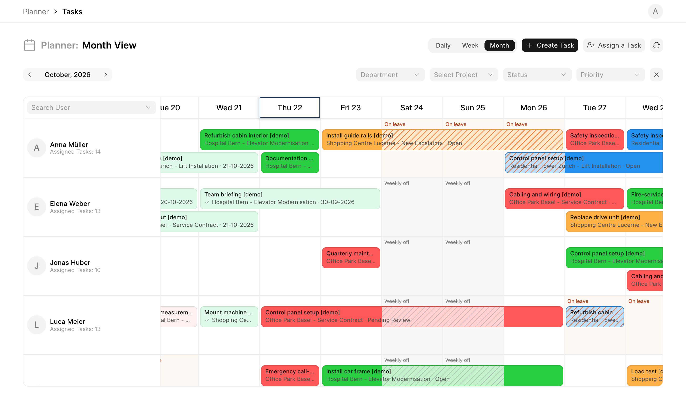
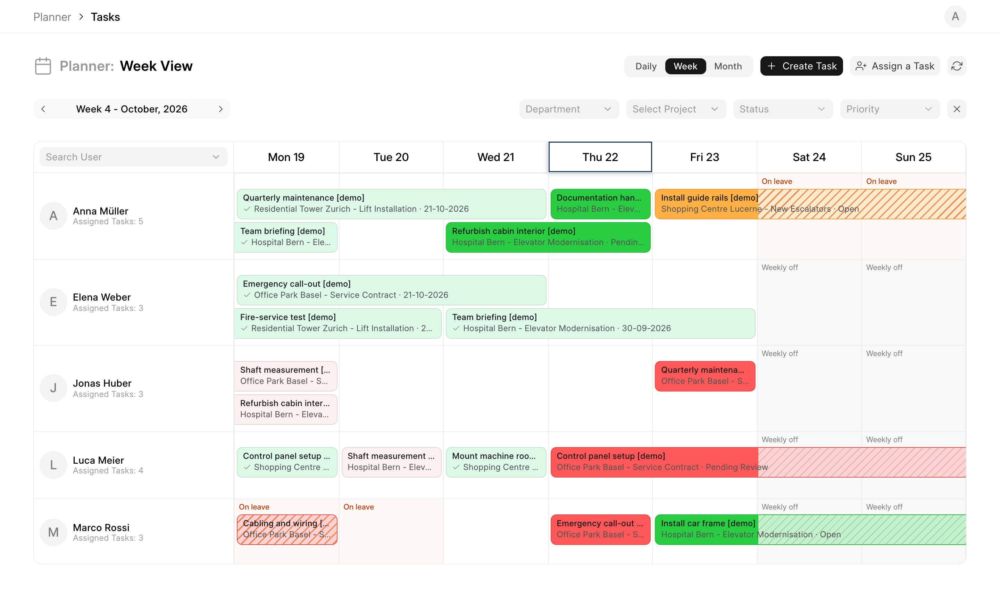
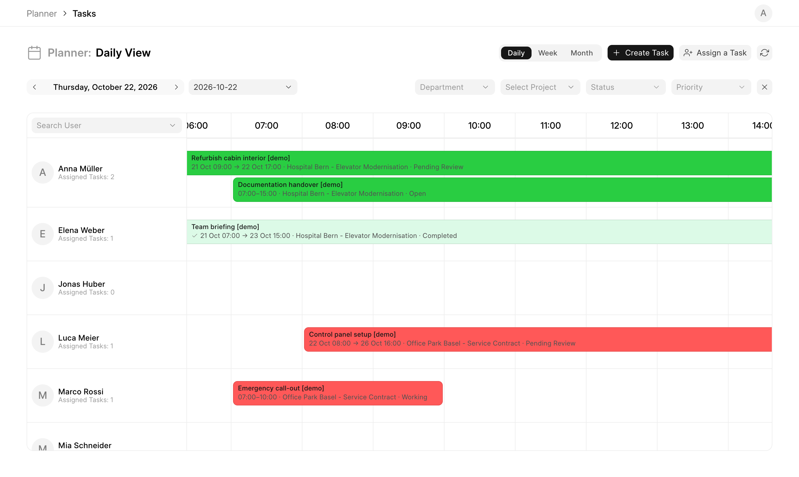

# Planner

Employee scheduling for ERPNext projects. See who works on what, day by day, alongside holidays and leave.



## Features

- **Month, week and day views**, switched from the toolbar.
- **Tasks as continuous bars** from start to end, across days or, in the day view, across hours. Overlapping tasks stack.
- **Holidays, weekly offs and leave** from HRMS, shown per person. A task running over a day off is hatched grey, over leave hatched orange, so booking clashes stand out.
- **Create and assign tasks** to one or more people with dates, times, status and priority. Click a bar to edit it, hover for details.
- **Filters** by department, project, status and priority, plus a user search.
- **Project contacts** and **project checklists** (with photos, a print format and email to the customer) on ERPNext projects.
- **Role-based access**: Projects User, Projects Manager and System Manager. Leave types are shown only to HR roles.

| Week | Day |
| --- | --- |
|  |  |

## Requirements

Frappe with [ERPNext](https://github.com/frappe/erpnext) and [HRMS](https://github.com/frappe/hrms).

## Installation

```bash
bench get-app hrms
bench get-app https://github.com/onfuseag/planner
bench --site <your-site> install-app hrms
bench --site <your-site> install-app planner
```

Open `https://<your-site>/planner`.

## Usage notes

- People appear in the planner when they are enabled system users linked to an active Employee.
- A task shows up once it is assigned to someone and has an expected start and end. A task without times counts as all day.
- If the `elevator` app is installed, tasks can also be linked to an elevator.

## Development

```bash
cd apps/planner/frontend
yarn dev     # dev server
yarn build   # production build into planner/public/frontend
```

## Help

Intro video: https://youtu.be/jWRGckBxVxA

## License

MIT
